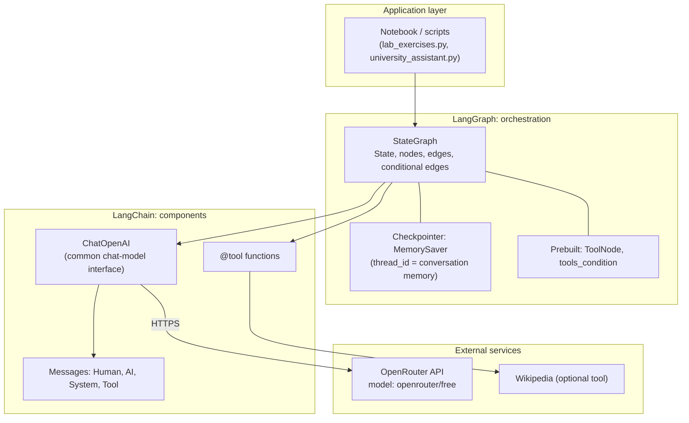
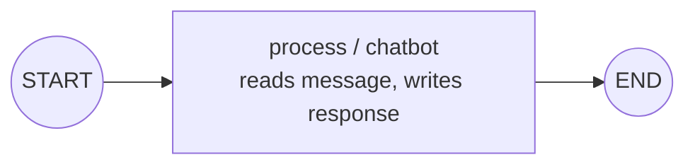
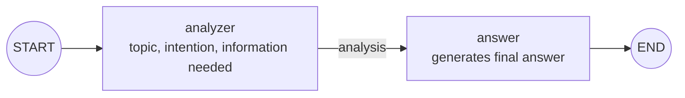
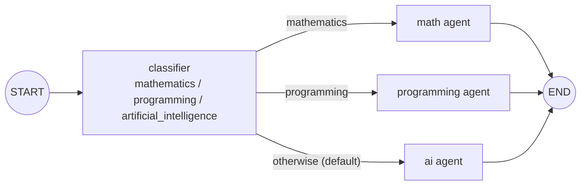
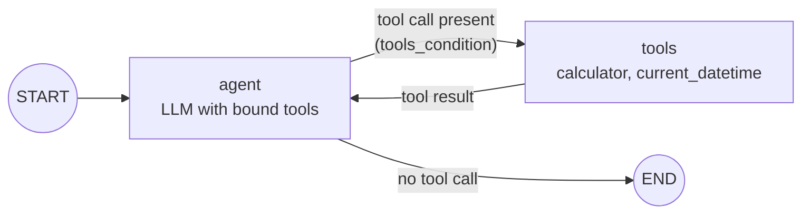
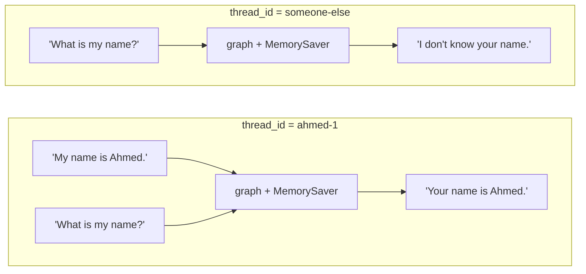
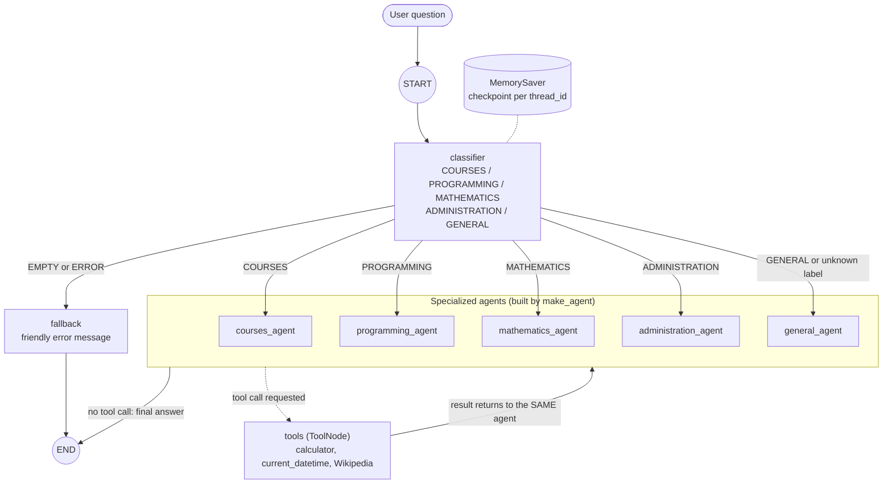
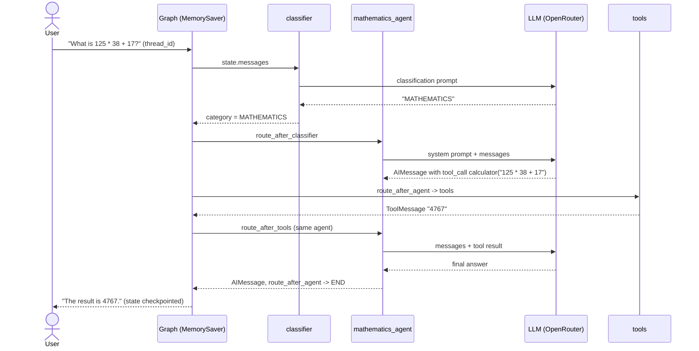
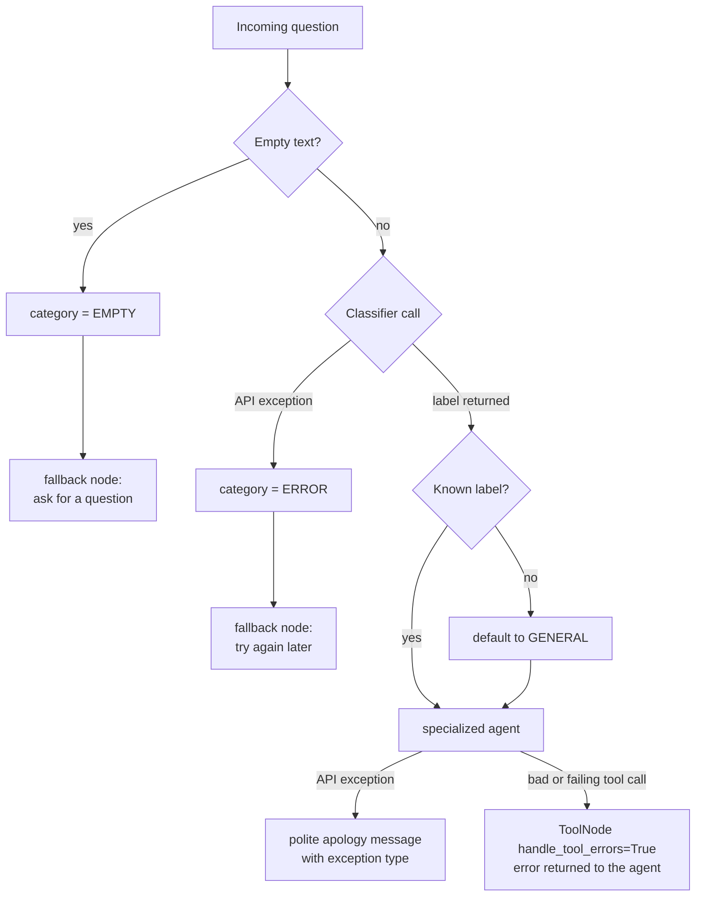

# Building AI Agents with LangGraph

Practical lab for *Advanced Artificial Intelligence / Generative AI* (PhD level). It builds, step by step, from a one-node graph to an **Intelligent University Assistant** with a classifier, specialized agents, tools, memory, conditional routing and error handling.

**Stack:** Python 3.12 · LangGraph 1.2 · LangChain 1.4 · `langchain-openai` · OpenRouter (`openrouter/free`)

---

## Repository layout

```text
.
├── README.md                       # this file (architecture + how to run)
├── langgraph_lab_Statement.ipynb   # executed notebook with outputs and written answers
├── university_assistant.py         # capstone: tools, classifier, agents, graph, demo
├── lab_exercises.py                # Parts II-IX: state, routing, tools, memory, evaluation
└── requirements.txt
```

`lab_exercises.py` imports the LLM builder and tools from `university_assistant.py`.

---

## 1. System architecture (layers)



| Layer | Role |
|---|---|
| **LLM** (via OpenRouter) | Understands the request, reasons, and decides when a tool is needed. It does not execute actions itself. |
| **LangChain** | Provides the chat-model interface, message types and `@tool` definitions, independent of the provider. |
| **LangGraph** | Runs the workflow: shared state, nodes, edges, loops, conditional routing and persistence. |
| **Tools** | Python functions that perform actions: safe calculator, date/time, optional Wikipedia. |

---

## 2. Exercise graphs (Parts II-IX)

### 2.1 Echo workflow (Exercise 2) and LLM node (Exercise 4)

State: `{message, response}`. Each node returns a partial update that LangGraph merges into the state.



### 2.2 Two-stage agent (Exercise 5)

State: `{question, analysis, answer}`.



### 2.3 Router with conditional edges (Exercises 6-7, Part VI)

State: `{question, category, answer}`. `route_question` inspects `category` and returns the next node name; anything unrecognized falls back to `ai`.



### 2.4 Tool-using agent (Parts VII-VIII)

State: `MessagesState`. The LLM is bound to the tools and decides whether to call one; the loop returns to the agent with the tool result.



### 2.5 Memory (Part IX)

The `add_messages` reducer appends to `messages`. Persistence comes from the checkpointer and the `thread_id`.



---

## 3. Capstone: Intelligent University Assistant

### 3.1 Graph



### 3.2 Shared state

```python
class AssistantState(TypedDict):
    messages: Annotated[list, add_messages]   # full conversation (memory)
    category: str                             # COURSES | ... | GENERAL | EMPTY | ERROR
```

### 3.3 Routing functions

| Function | Decides | Returns |
|---|---|---|
| `route_after_classifier` | Which agent handles the question | `<category>_agent`, or `fallback` for `EMPTY` / `ERROR` |
| `route_after_agent` | Does the agent need a tool? | `tools` if the last message has `tool_calls`, else `END` |
| `route_after_tools` | Who continues after the tool? | The agent matching `state["category"]` (default `general_agent`) |

### 3.4 Request lifecycle (math question with a tool)



### 3.5 Error handling



### 3.6 Requirements mapping

| # | Requirement | Implementation |
|---|---|---|
| 1 | Question classifier | `classify` node → 5 categories + `EMPTY` / `ERROR` |
| 2 | Specialized agents | `make_agent(category)` with one system prompt each |
| 3 | Memory | `MemorySaver` + `thread_id` |
| 4 | Tools | `calculator` (AST-based), `current_datetime`, optional Wikipedia |
| 5 | Conditional routing | `route_after_classifier`, `route_after_agent`, `route_after_tools` |
| 6 | Error handling | Empty input, unknown label, API errors, invalid tool calls |

---

## 4. Design decisions

- **Safe calculator.** The lab's `eval()` can run arbitrary Python. The implementation parses with `ast` and allows only arithmetic operators, so `__import__('os')` returns `Invalid expression`.
- **Same agent after a tool.** `route_after_tools` returns control to the agent that asked, so the specialist writes the final answer.
- **Provider-agnostic LLM.** OpenRouter is used through `ChatOpenAI` with a custom `base_url`; switching back to OpenAI only changes `build_llm()`.
- **Secrets.** The API key comes from `OPENROUTER_API_KEY` or `getpass`, never from source code.

## 5. Known limitations

- The classifier reads only the **last message**, so ambiguous follow-ups may be misrouted.
- All agents share **one tool set**; specialization comes from system prompts.
- `MemorySaver` is **in memory** and lost on restart; use a SQLite or Postgres checkpointer for persistence.
- `openrouter/free` is a routing alias, so results are **not fully reproducible** even at `temperature=0`.
- Routing evaluation uses 6 easy questions and a substring match; a larger set with exact matching and a confusion matrix is recommended.

## 6. Run it

```bash
python -m venv .venv && source .venv/bin/activate     # Windows: .venv\Scripts\activate
pip install -r requirements.txt
export OPENROUTER_API_KEY="your-key"                   # Windows: setx OPENROUTER_API_KEY "your-key"

python university_assistant.py      # capstone demo (6 queries, memory test, tool trace)
python lab_exercises.py             # Parts II-IX and routing evaluation
```

To print the Mermaid source of any compiled graph: `graph.get_graph().draw_mermaid()`.
